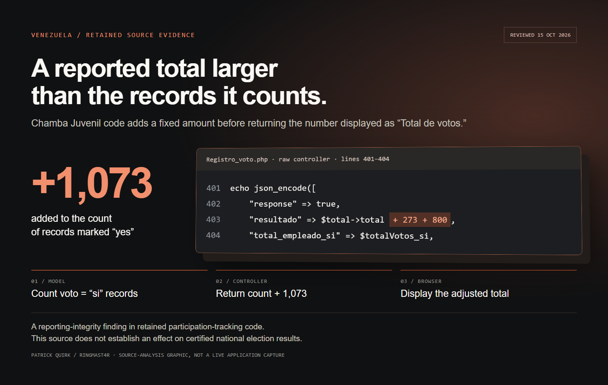

<div align="center">


</div>

# Retained code adds 1,073 to a voting-participation report

The recovered **Chamba Juvenil** controller returns a count of records marked `voto = "si"` **plus 273 plus 800**. The browser code takes that returned value and assigns it to a counter labeled **“Total de votos.”** This is a concrete reporting-integrity finding in the retained source.

```php
"resultado" => $total->total + 273 + 800,
```

[Read the exact controller line](raw/chamba-juvenil/application/controllers/Registro_voto.php#L403), then follow the [model → controller → browser evidence chain](ANALYSIS.md).



*The image is a source-analysis graphic, not a screenshot of a live government application. Its excerpt comes from the released file. The editable [evidence viewer](assets/evidence.html) is included.*

## `> understand_the_scope`

This repository preserves selected raw evidence from **two different retained collections**:

| Collection | What is released | What it supports |
| --- | --- | --- |
| Chamba Juvenil | Eight unmodified PHP/JavaScript files | A hard-coded increase in a reported participation count, a separate 800 fallback, and code linking voting status to identifying fields |
| PSUV / Guárico election application | Two saved GraphQL introspection responses and one small frontend HTML file | A schema exposing election-related operations, including `createAdmin` and `setVotacion` |

**These are not interchangeable systems.** The Chamba source finding is not being attributed to the PSUV GraphQL backend. The recovered PSUV material is a schema and frontend shell, **not its backend implementation**.

The voting form asks **“¿VOTO?”** with yes/no choices. That supports interpreting the Chamba count as **recorded participation**, not a tally for a candidate. The reviewed files do **not** establish an effect on CNE-certified national results, the intent behind the constants, or deployment of this exact code during a particular election. Schema visibility alone does not establish permission to execute mutations.

## `> verify_the_release`

```bash
python scripts/verify_evidence.py
```

This offline check verifies all 11 raw-file SHA-256 hashes and the cited source patterns. It does not execute the recovered PHP application, contact a government service, or test a mutation. The arithmetic examples it prints are derived illustrations, not observed election totals.

- [Analysis and source-line references](ANALYSIS.md)
- [Provenance, selection, and exclusions](PROVENANCE.md)
- [Machine-readable manifest](manifest.json) and [SHA256SUMS](SHA256SUMS)
- [Rights and reuse](RIGHTS.md)

## `> why_release_this`

A dashboard presented as a vote count should be traceable to its underlying records. This source contains an unexplained fixed addition in that path. Publishing the relevant files makes the finding independently inspectable and gives journalists and researchers specific code to question, rather than asking them to accept a broad allegation.

This is a selected evidence release by **Patrick Quirk / Ringmast4r**. Personal-record exports, credential material, keys, and unrelated archival data are excluded. Included raw files are unchanged; the selection is not the entire recovered application.

## `> full_tech_stack`

| Layer | Implemented content |
| --- | --- |
| Retained application evidence | PHP / CodeIgniter-style controllers, model and views; JavaScript / jQuery counter logic; JSON GraphQL introspection responses; HTML frontend shell |
| Verification | Python 3 standard library (`hashlib`, `json`, `re`, `pathlib`); no package installation or service access required |
| Evidence display | Local HTML/CSS source viewer with a perspective code panel; captured PNG; no external scripts |
| Integrity | SHA-256 manifest and sums; Git attributes preserve raw bytes |
| Publication | Static files on GitHub; no recovered application deployed and no executable government service hosted |
| Validation | All 11 hashes and cited code patterns checked locally; source viewer visually inspected; fresh-clone verification recorded in the release commit's accompanying work |


